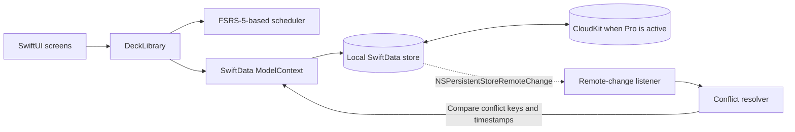

For the past three months, I've been working on iToth, a flashcard app designed for studying. I had been thinking about building such an app for some time, but I never had the time. Now that AI tools have become better at coding, I can use them to implement most of the boilerplate and focus on what I really want to learn: AI-assisted development, SwiftData, and iCloud synchronization.

_The iToth library and chapter experience running on iPhone._

The first version Claude generated worked. The problem was that it did not look like software I would have written. Because of that, I started teaching Claude how I build software. During that process, I created my own AI skill with a set of rules that helped it produce a more modular architecture and stronger tests. I was particularly satisfied with the testing strategy I developed to validate AI output and prevent regressions.

## Teaching the Agent How I Build Software

Building an app involves much more than code: it requires an interface, images, icons, a website, and marketing assets. I left code off that list on purpose because design, not programming, is my weakness. Claude helped me by creating images, recording videos, and producing marketing materials.

### When the Generated Code Became Too Complex

I started the project by asking Claude, acting as my coding agent, to set up an iOS and macOS project for a simple flashcard app. I began with a card containing a question that revealed the answer when the user tapped it. Claude's initial code was good enough for a first draft. As I explored software development with AI agents, I began adding my architectural and coding preferences to my `ios-dev` skill. Eventually, I realized that what I really wanted was a clone of myself. I started with some basic instructions:

> - Do not implement anything without unit tests, except interface code, which will be covered by end-to-end tests.
> - For every bug, first create a failing unit test that proves the bug exists. Then fix the problem and make the test pass to prove that it has been resolved.
> - Use the View Model pattern with a separate service layer. For a small app, this architecture is more than enough.
> - Most of the app should run on the `MainActor`, so use that as the default. When necessary, use `@concurrent` to opt out of the `MainActor` and perform work in the background.

These four rules made Claude a better iOS coding agent and improved its output. New behavior was covered by tests, and the code followed a simple architecture. However, as I requested more complex features, the agent began putting too much code in individual files.

### Designing a Deeper Architecture

The challenge was deciding how much code should live in a single file. A file containing 700 lines of code can be difficult to understand and change. However, I did not want to introduce an arbitrary rule such as "do not create files with more than 200 lines of code" because complex code sometimes belongs together. Spreading it across five files can make it even harder to understand.

Recently, I have been reading the excellent [*A Philosophy of Software Design*](https://web.stanford.edu/~ouster/cgi-bin/book.php) by John Ousterhout, which describes many ways to manage complexity. One chapter discusses whether line count is a useful measure of complexity. Ousterhout's argument matched my intuition: most of the time, line count does not matter. What matters is the complexity of the task and how effectively a module hides it behind a simple interface while providing deep functionality.

I translated that concept into one more rule:

> Organize the code by domain. Create modules that represent different parts of the system and let them communicate through simple interfaces.
>
> A simple interface can be a wrapper around a module that exposes most of its internal functionality through a few functions or classes. The module is deep, but the interface hides the complexity.

That instruction changed how the agent wrote the code. Claude responded by creating a new set of Swift Package modules:

| Module | Responsibility | Public interface |
|---|---|---|
| `ImportKit` | Import decks | Import operation and result |
| `ShareKit` | Export and share decks | Share operation |
| `CardKit` | Study and synchronization logic | Library API |
| `Model` | Shared data structures and parsing | Models and parser |

The modular structure was much better than what I had when I started. Claude had begun to understand how I write code and how I prefer to separate responsibilities.

## New Lessons for the Human: SwiftData and iCloud Synchronization

I started investigating how to synchronize everything so that users could see their cards on macOS. I had tried SwiftData before, but never in depth, and I had never worked with iCloud. I began by drawing the data flow of my app and deciding how the synchronization logic should work.

_The data flow keeps UI and scheduling behind `DeckLibrary`, while remote SwiftData changes pass through a dedicated conflict-resolution path._

The diagram is simple because `DeckLibrary` hides most of the synchronization logic behind a small interface. SwiftData is simpler than Core Data, which I have used throughout my career, but adding iCloud introduces a different category of problems.

After a background CloudKit import writes to the local persistent store, Core Data posts an `NSPersistentStoreRemoteChange` notification. iToth then groups records by logical key, keeps the record with the latest timestamp, deletes duplicate rows, and saves those deletions through SwiftData.

One challenge is that a CloudKit-backed SwiftData model does not support unique constraints, so the same logical record can be created both remotely and locally. iToth addresses this problem with a two-level conflict-resolution strategy:

1. SwiftData's CloudKit integration synchronizes updates to the same persistent object.
2. iToth's custom resolution pass handles separate SwiftData rows that represent the same logical entity:

| Data | Conflict key | Resolution |
|---|---|---|
| Deck customization | `deckID` | Record with latest `modifiedAt` |
| Card progress | deck ID plus card ID | Record with latest `lastReview` |
| User-created book | `bookID` | Record with latest `modifiedAt` |
| Card image | deck ID plus image name | Record with latest `createdAt` |
| Review history | No shared key | Entries are append-only and all are preserved |

The losing duplicate is then deleted, and SwiftData saves the context. This is essentially a last-write-wins merge strategy. However, there is a trade-off: because there is no field-by-field comparison, simultaneous edits can be difficult to merge. I think this is acceptable because it is a specific and unlikely edge case.

This was the part of the project that taught me the most. I had handled similar synchronization conflicts in my day-to-day work, but never with SwiftData and iCloud. Working through the problem with Claude turned the project from a code-generation exercise into an opportunity to learn a new persistence stack.

Once the conflict-resolution logic was in place, I needed to prove that it worked—not only in the expected cases, but also during failures, duplicate creation, and simultaneous changes. That led me to a broader question: how should I validate software generated with AI?

### Validating AI-Generated Software

Every project needs a way to verify that its behavior is correct. As AI-generated code becomes more common, reliable verification becomes even more important. I created a three-layer testing structure:

#### Three layers of testing

**Unit tests.** I always ask Claude to prove that something works with unit tests. When I report a bug, I ask it to prove that the bug exists by creating a failing test before fixing the problem and making the test pass.

**End-to-end tests.** Automated tests are a great way to prevent regressions. I wanted to support the iPhone Duo, whose developer tools arrived late and were buggy (thanks, Apple!), so I needed a reliable way to validate the app's behavior. I automated all the flows with [Maestro](https://maestro.dev/), a tool that I have also been studying at work.

**Demo mode.** I needed a reliable way to test every feature, so I asked Claude to create a demo mode. This mode also made it easier to record videos and capture screenshots with consistent test data.

Together, these three approaches gave me solid test coverage.

#### Test suite at a glance

| Metric | Count |
|---|---:|
| Unit tests | **145** |
| Maestro flows | **26** |
| Swift modules under test | **4** |

#### Representative test scenarios

I wrote descriptions for several test cases and asked Claude to identify missing edge cases. The process gave me a rich test suite. Here are some examples:

- **Preserve the library during purchase-state changes:** Buying or repurchasing Pro, restoring a purchase, or handling an expiration must switch synchronization modes without losing the existing on-disk library.
- **Handle an iCloud failure:** If opening the CloudKit-enabled store fails, the local library must still load. The app then schedules another attempt to synchronize with iCloud.
- **Prevent progress from being overwritten:** This test verifies that the most recent progress on a deck is saved while preserving both review events for statistics. If a user reviews a card at 10:00 on an iPhone and marks it as difficult, then reviews it on a Mac at 11:00 and marks it as easy, the Mac review wins, but both events are saved to preserve the user's statistics.

#### Regressions caught by the tests

- **The saved library disappeared when iCloud failed at launch** — Removing the local recovery behavior caused the launch-failure tests to fail.
- **Refunds and Ask to Buy approvals did not update the app** — Disabling the StoreKit transaction listener caused both hosted purchase tests to fail.
- **Library data was lost during storage-mode transitions** — Forcing every store reopening to use local mode caused the restore and persistence regression test to fail.

I configured Xcode to run the unit tests and end-to-end tests before every archive, so I can be confident that no regressions were introduced during the final stage of development. The tests completed the feedback loop: Claude had my architectural preferences, but it also had an objective way to prove that its changes preserved the app’s behavior.

## What I Learned Building iToth with AI

- **AI-assisted development is an iterative process.** You write a prompt, review the output, and then refine it using your own knowledge. This loop is where an engineer's experience remains essential.
- **Do not rely solely on AI verification.** Create your own test suite and challenge the AI with failures and edge cases. This will greatly improve the overall quality of the software and reduce regressions in your project.
- **Create a skill.** Use skills to capture your preferences and working methods. This helps the agent with every task by reducing the time needed to correct its approach.

AI can greatly improve a software engineer's productivity, but the accumulated knowledge of an experienced professional makes a significant difference in guiding the agent and improving its output.

Interested in the app behind these experiments? Visit [itoth.app](https://itoth.app/).
